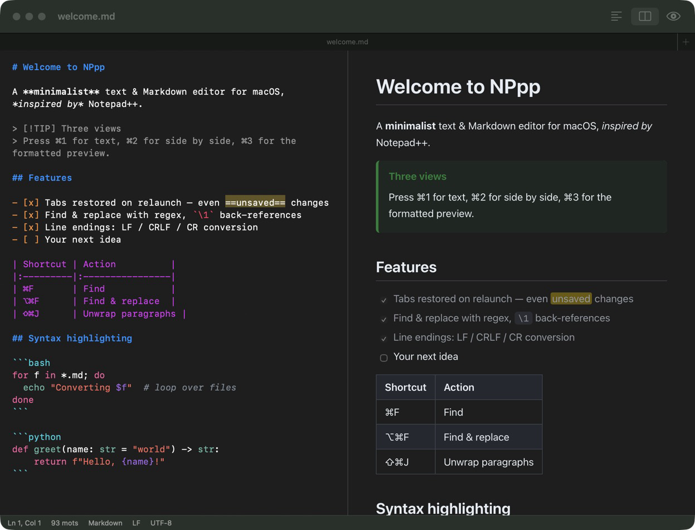

# NPpp

**A minimalist, native macOS text & Markdown editor inspired by Notepad++.**



NPpp brings the Notepad++ essentials to the Mac: tabs that survive a restart, a serious find & replace, line-ending and encoding conversions, syntax highlighting — plus a readable live preview for Markdown files.

It is a single, dependency-free Swift/AppKit app (~3,500 lines). No Electron, no web framework, no telemetry.

> The user interface is currently in **French** (menus, dialogs). Shortcuts are standard macOS ones and are listed below.

## Features

### Tabs & session
- Native macOS tabs (⌘T new, ⌘W close, ⇧⌘T reopen closed tab, ⌃Tab next tab).
- **Everything is restored on relaunch**: open tabs, cursor position, view mode — including *unsaved* changes and untitled tabs. Quitting never asks questions.
- Files changed by another app (Dropbox, another editor, `git pull`…) are reloaded automatically; if you also have unsaved edits, you choose which version to keep.

### Three views — ⌘1 / ⌘2 / ⌘3
- **Text** — plain editor, monospaced, with light Markdown highlighting.
- **Side by side** — editor and preview with synchronized scrolling.
- **Preview** — formatted Markdown: headings, nested lists, task lists, tables, blockquotes, GitHub/Obsidian callouts (`> [!NOTE]`), fenced code with syntax highlighting, links, relative images, `[[wikilinks]]`, YAML front matter, `==highlight==`, light & dark mode. Clicking a link to another `.md` file opens it in a new tab.

### Find & replace — ⌘F / ⌥⌘F
- Options: match case, whole word, **regular expressions**, and Notepad++'s *extended* mode (`\n`, `\t`, `\\`).
- Regex replacements accept `\1` or `$1` back-references and `\n` / `\t`.
- All matches highlighted, with a live “3 of 12” counter. ↩ next, ⇧↩ previous.
- **Replace all** in the whole document or only in the selection — undone in a single ⌘Z.

### Syntax highlighting
Bash / Zsh / sh · Python · HTML (with embedded CSS & JavaScript) · XML · CSS / SCSS · JavaScript · TypeScript · JSON · YAML · INI / TOML / conf · SQL · Swift · PowerShell · C / C++ / Objective-C · Java / Kotlin · Go · Rust · Dockerfile · Makefile · Diff

The language is detected from the file extension, well-known file names (`.zshrc`, `Dockerfile`, `Makefile`…) or the `#!` shebang line, and can be forced from the **Langage** menu. Colors follow an Xcode-like palette in both light and dark mode. Fenced code blocks inside Markdown (` ```python `) are highlighted in the editor *and* in the preview.

### Text tools (Format & Édition menus)
| Category | Operations |
|:--|:--|
| **Line endings** | Detect & convert LF / CRLF / CR (shown in the status bar) |
| **Encoding** | UTF-8, UTF-8 with BOM, UTF-16, ISO-8859-1, Windows-1252, Mac Roman — convert on save, or *re-open with* an encoding to fix garbled accents |
| **Paragraphs** | Join lines (⌘J), **unwrap paragraphs** (⇧⌘J — removes hard line breaks, e.g. text pasted from a PDF), one blank line between lines, remove / collapse blank lines |
| **Lines** | Duplicate (⌘D), move up / down (⌥⌘↑ / ⌥⌘↓), delete (⇧⌘K), sort A→Z / Z→A, reverse, remove duplicates |
| **Whitespace** | Trim trailing spaces, tabs → spaces, leading spaces → tabs |
| **Case** | UPPER, lower, Title Case, Sentence case |
| **Markdown** | Bold ⌘B, italic ⌘I, strikethrough ⇧⌘X, code ⇧⌘C, link ⌘K, cycle heading ⇧⌘H, toggle task ⇧⌘L |

### View
- **Show invisibles** (⌥⌘I): spaces `·`, tabs `→` and an `LF` / `CRLF` badge at each line end, Notepad++-style.
- Word wrap (⌥⌘W), font size (⌘+ / ⌘− / ⌘0), status bar with line, column, word count, language, line ending and encoding.

## Install

### Download
Grab `NPpp.zip` (Apple silicon, macOS 13+) from the [latest release](../../releases/latest), unzip it and move `NPpp.app` to `/Applications`.

The app is not notarized by Apple, so macOS will block the first launch. Either right-click the app → **Open**, or run:

```bash
xattr -dr com.apple.quarantine /Applications/NPpp.app
```

### Build from source
Requires macOS 13+ and the Swift toolchain (the Xcode **Command Line Tools** are enough — no full Xcode needed).

```bash
git clone https://github.com/jsopdebeeck/NPpp.git
cd NPpp
./build.sh           # builds dist/NPpp.app
./build.sh install   # …and copies it to ~/Applications
```

To make NPpp the default app for Markdown files: select a `.md` file in Finder → ⌘I → *Open with* → NPpp → *Change All…*

You can also open files from the terminal: `open -a NPpp notes.md script.sh`.

## Project layout

```
Sources/NPpp/
├── AppDelegate.swift         app lifecycle, tabs, session save/restore
├── EditorController.swift    one tab: editor, preview, status bar, find & replace
├── FindBar.swift             find / replace bar and regex engine options
├── TextOps.swift             line, paragraph, whitespace, case and Markdown commands
├── Markdown.swift            dependency-free Markdown → HTML renderer
├── Highlighter.swift         Markdown highlighting + invisible-character drawing
├── Syntax.swift              generic regex-based highlighting engine
├── SyntaxDefinitions.swift   language grammars — add a language here
├── TextFile.swift            encodings, BOM and line-ending detection
├── PreviewTemplate.swift     preview HTML/CSS
├── Session.swift             session file (~/Library/Application Support/NPpp)
└── MainMenu.swift            menus and keyboard shortcuts
```

`examples/` contains sample files (Markdown, Bash, Python, HTML) to try the highlighting.

### Adding a language
Add an entry to `SyntaxDefinitions.swift`: a list of regex rules in priority order (comments and strings first), file extensions, and optional shebang names / aliases. The engine scans left to right with a single combined regex, so a `#` inside a string is never mistaken for a comment.

## Credits

Inspired by [Notepad++](https://notepad-plus-plus.org/) by Don Ho. NPpp is an independent project and is not affiliated with Notepad++.

Built with the help of [Claude Code](https://claude.com/claude-code).

## License

[MIT](LICENSE)
